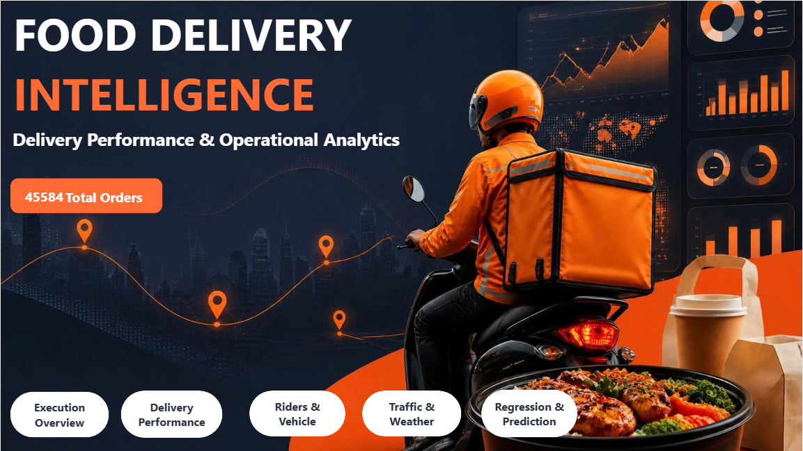
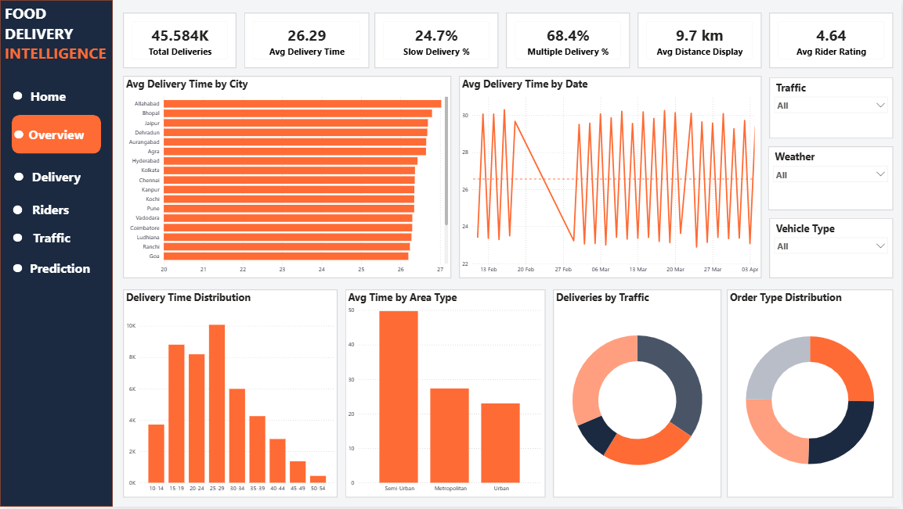
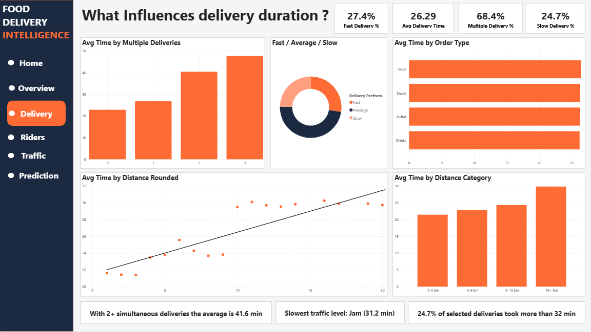
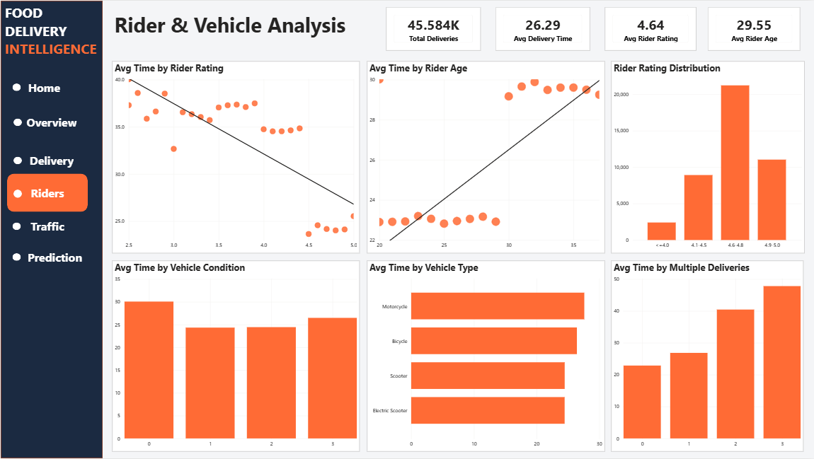
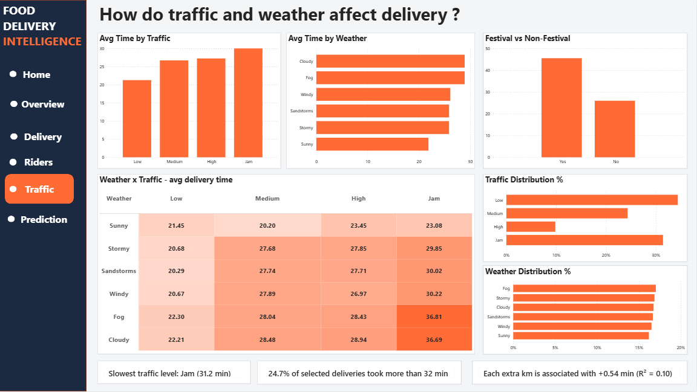
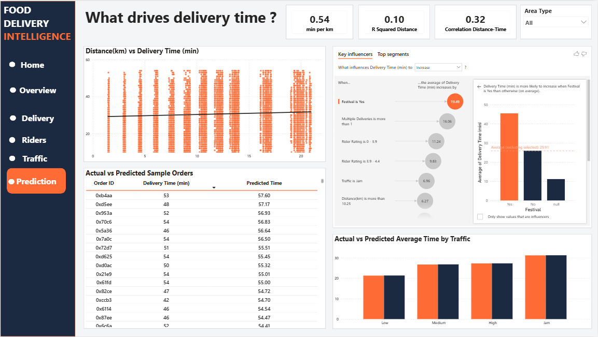

# Zomato Food Delivery Analysis

## Project Overview
This project presents an interactive food delivery analysis dashboard developed using Microsoft Power BI. It explores delivery operations, traffic, rider performance, and prediction-related analysis.

## Objectives
- Analyze food delivery operations and performance.
- Explore traffic conditions affecting deliveries.
- Examine rider and delivery-related metrics.
- Present insights through interactive dashboard pages.
- Explore prediction-related analysis included in the project.

## Tools and Technologies
- Microsoft Power BI
- Microsoft Excel
- DAX 

## Dashboard Preview

### Home Page

### Overview

### Delivery Analysis

### Rider Analysis

### Traffic Analysis

### Prediction Analysis

## Project Files
- `Food Analysis Dashboard.pbix` — Power BI dashboard file.
- `Zomato Dataset.xlsx` — Excel dataset used in the project.
- `A5_Report.docx` — Project report.
- PNG files — Dashboard screenshots.

## Live Video Demo
https://lnkd.in/p/dPzmCF7w

## How to Explore
1. Clone or download this repository.
2. Open `Food Analysis Dashboard.pbix` using Power BI Desktop.
3. Review the dashboard pages and interact with the available visuals.
4. Refer to the project report for additional documentation.

## Author
Sanika Kate
